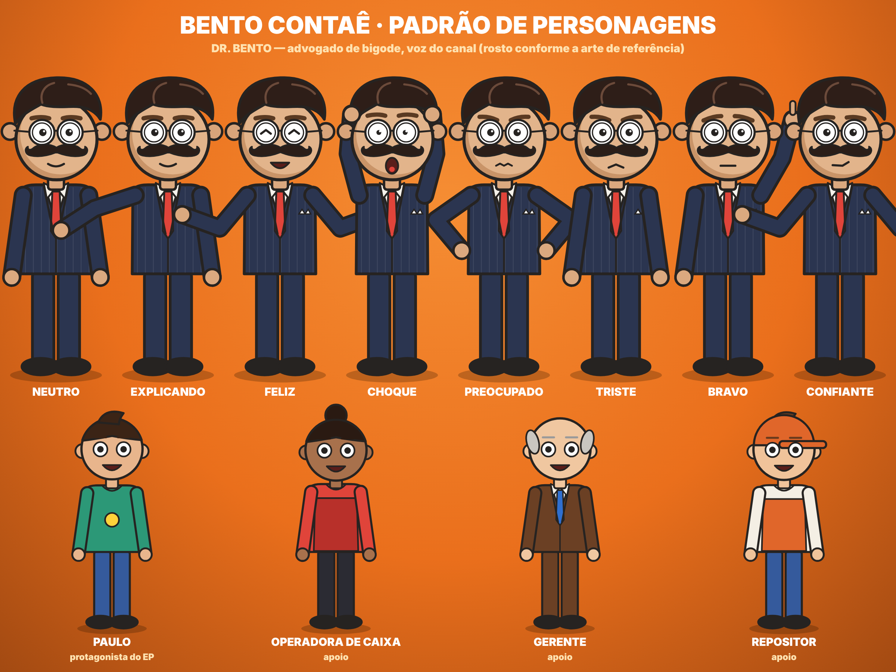

# Bento Contaê — padrão de personagens

Todo vídeo do canal usa este elenco e este traço (2D chapado, contorno escuro grosso, cores sólidas).
O código dos personagens está em `moedas/video/src/Person.tsx` (componente `<Person>`), e a folha acima é gerada pela
composição `personagens` (`cd moedas/video && node stills.mjs personagens ../../personagens 0`).

## Dr. Bento (fixo em todo episódio)
- Advogado e "voz" do canal. Bordão quando entra a lei: **"Calma, que o Bento conta."**
- **Rosto conforme a arte de referência:**
  - cabelo castanho-escuro cheio, arredondado e com risca;
  - óculos redondos de aro duplo e olhos grandes com brilho;
  - sobrancelhas grossas e bigode de pontas enroladas;
  - sorriso pequeno, pele clara com sombra na bochecha.
- **Corpo:**
  - terno azul-marinho risca de giz com lenço branco no bolso;
  - camisa branca de gola em ponta e gravata vermelha;
  - calça azul-marinho e sapato preto.
- **Expressões:** neutro, explicando, feliz, choque, preocupado, triste, bravo, confiante. Também segura objetos, coça a cabeça, aponta, acena, anda e corre.
- Sem plaquinha com o nome na tela.

## Elenco de apoio
- Muda a cada episódio, mas sempre no mesmo traço: cabeça grande e redonda, corpo de "caixinha", braços em tubo e sapatos ovais.
- Já desenhados: **Paulo** (protagonista do EP "Preço errado"), **operadora de caixa**, **gerente** e **repositor**.
- Para criar um personagem novo, basta um novo `Spec` em `Person.tsx`, escolhendo cabelo (`short`, `quiff`, `slick`, `bun`, `grey`, `bald`), cores de pele, roupa, avental, boné, gravata etc.
